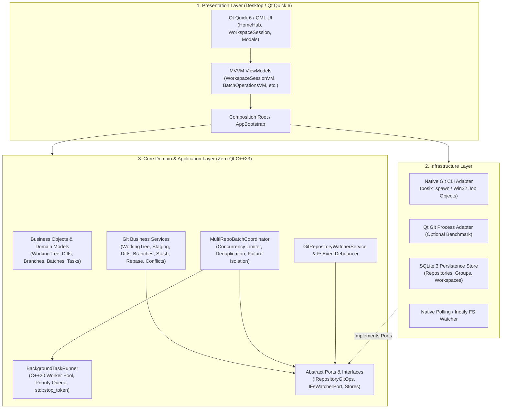

<div align="center">

# ⎇ Git Flux

### Ultra-Fast, Local-First, Multi-Repository Git Client
**Crafted with Modern C++23, Clean Architecture, and Hardware-Accelerated Qt Quick 6**

[](https://en.cppreference.com/w/cpp/23)
[](https://www.qt.io/)
[](#architecture--clean-design)
[](#platform-support)
[](LICENSE)

<br/>

> **Git Flux** is a high-performance desktop Git client built for software engineers who manage complex multi-repository architectures, microservices, and monorepos. Born to replace bloated Electron-based Git GUIs, Git Flux pairs **sub-millisecond native OS execution** with an ergonomic, dark-themed **Qt Quick** interface.

</div>

---

## ⚡ Why Git Flux?

- **🚀 Blazing Native Performance:** Built in pure C++23. Utilizes `posix_spawn` on Linux/macOS and Win32 Job Objects on Windows to spawn Git processes with near-zero overhead. Memory usage is a tiny fraction of Chromium/Electron-based alternatives.
- **🛡️ Clean Architecture (Zero-Qt Core):** All domain logic, Porcelain Git parsers, SQLite repositories, and background worker threads live in pure standard C++23 without any dependency on GUI frameworks. Fully decoupled, portable, and testable in headless CI environments.
- **📂 Context-Driven Multi-Repository Management:**
  - **Home Hub:** Easily categorize repositories into customizable **Groups** or persistent **Workspaces**.
  - **Quick Open Modal (`⚡`):** Instant fuzzy-search switching across all registered repositories and groups.
  - **Multi-Tab Sessions:** Open dozens of repositories simultaneously without UI degradation.
- **🔄 Multi-Repository Batch Automation:**
  - Execute **Fetch All**, **Pull All**, and **Bulk Status** across entire Groups or Workspaces with a single click.
  - Configurable **Concurrency Limiter** (parallel semaphore) to protect network sockets and bandwidth.
  - **Failure Isolation:** An authentication error or remote outage on one repository does not abort the remaining repositories.
  - Per-repository progress telemetry, atomic outcome reporting, and cooperative cancellation.
- **⏱️ Reactive File System Watcher & Debouncing Engine:**
  - Intelligent event classification distinguishing internal Git mutations (`.git/HEAD`, `.git/refs/`, `.git/index`) from working directory changes.
  - Low-overhead noise filtering (ignores `.git/objects/`, `.git/logs/`, editor swap files, lockfiles).
  - Configurable quiet-period debouncing (200ms) with anti-starvation ceilings (1000ms) to consolidate high-frequency disk activity into clean, single batch updates.
- **🎯 Full-Featured Git Toolset:**
  - **Working Tree Panel:** Unstaged & Staged file models, file-level and hunk-level staging/unstaging, and discarding.
  - **Commit Box:** Summary, description, Amend Commit support, and Signed-off-by helpers.
  - **Diff Viewer:** Unified and Side-by-Side hunk diff viewer with colorized additions, deletions, line numbering, and hunk headers.
  - **Branch Manager:** Local & remote tracking branches, upstream configuration, fast-forward merges, switch, create, rename, and delete.
  - **Commit History Graph:** Chronological topological commit log with author avatars/initials, relative timestamps, short SHAs, and commit summaries.
  - **Stash Manager:** Push with optional untracked (`-u`) and keep-index, Apply, Pop, Drop, and Clear stashes with inline status notifications.
  - **Interactive Rebase & 3-Way Conflict Resolver:**
    - Live banner indicator for ongoing rebase operations with Continue, Skip, and Abort controls.
    - Hunk-by-hunk conflict resolution modal allowing developers to accept *Ours* (Current), *Theirs* (Incoming), *Base*, or *Combined* content.

---

## 🏛️ Architecture & Clean Design

Git Flux strictly follows **Clean Architecture** / **Hexagonal Architecture** principles. The application is divided into three completely decoupled layers:



### Dependency Rules:
1. **Zero-Qt in Core:** `src/core/` does not include `<QObject>`, `<QString>`, or any Qt header. It compiles in 100% standard C++23.
2. **Explicit Composition Root:** Dependencies are wired at startup in `src/desktop/bootstrap/app_bootstrap.cpp`. ViewModels receive pure C++ domain services through constructor injection.
3. **Thread-Safe Dispatching:** Background worker notifications (e.g., File System Watcher debounced batches, Task Runner progress) are dispatched onto Qt's main GUI thread using `QMetaObject::invokeMethod(..., Qt::QueuedConnection)`.

---

## 📂 Project Structure

```text
GitFlux/
├── CMakeLists.txt              # Unified CMake configuration (targets, presets, warnings)
├── CMakePresets.json           # Native CMake Presets for Linux and Windows
├── assets/                     # Visual assets, logos, and fonts
├── docs/                       # Architectural specifications & phase documentation
│   ├── plan.md                 # Complete project roadmap & technical plan
│   ├── phase0-benchmarks.md    # Sub-process performance benchmarks (posix_spawn vs QProcess)
│   ├── phase1-foundation.md    # Domain entities, SQLite stores, registry
│   ├── phase2-working-tree.md  # Working tree, status, stage, diff, commit
│   ├── phase3-branches.md      # Branch manager, remote operations, commit log
│   ├── phase4-stashing.md      # Stash manager, rebase, 3-way conflict resolver
│   └── phase5-performance.md   # Watchers, debouncing, task runner, batch coordinator
├── scripts/
│   └── linux/                  # Developer utilities (build.sh, test.sh, run.sh, clean.sh, check.sh)
├── src/
│   ├── core/                   # 100% Zero-Qt C++23 Core
│   │   ├── modules/
│   │   │   ├── git/            # Domain BO, ports & BL services (status, diff, branch, stash, rebase, batch)
│   │   │   ├── repositories/   # Repository registry & path resolution
│   │   │   ├── groups/         # Group domain services
│   │   │   ├── workspaces/     # Workspace domain services
│   │   │   └── tasks/          # Background worker pool & cooperative task runner
│   │   └── shared/             # Common domain primitives (StrongId, timestamps)
│   ├── infrastructure/         # External adapters & system integrations
│   │   ├── git/                # Native OS Git CLI executor (posix_spawn / Windows)
│   │   ├── persistence/        # SQLite 3 schema migrations & store implementations
│   │   └── watcher/            # Native file system polling and inotify adapters
│   └── desktop/                # Presentation Layer (Qt Quick 6 / QML)
│       ├── bootstrap/          # Composition Root (AppBootstrap)
│       ├── viewmodels/         # MVVM ViewModels (QAbstractItemModel adapters)
│       └── ui/qml/             # Modern dark QML views, modals, and FluxTheme
├── tests/
│   ├── unit/                   # Fast Catch2 unit tests (Core, Persistence, MVVM)
│   └── integration/            # Real-world Git repository integration tests
├── third_party/
│   └── sqlite/                 # Embedded SQLite 3 amalgamation library
└── tools/
    └── fixture_gen/            # Synthetic Git repository fixture generator
```

---

## 🛠️ Prerequisites & Toolchain

| Requirement | Minimum Version | Note |
| :--- | :--- | :--- |
| **C++ Compiler** | GCC 13+ / Clang 16+ / MSVC 2022 | Must support ISO C++23 (`-std=c++23`) |
| **CMake** | 3.25+ | Required for `CMakePresets.json` version 6 |
| **Build Generator** | Ninja / Visual Studio | Ninja is recommended for ultra-fast builds |
| **Qt Framework** | Qt 6.6+ | Components: `Core`, `Gui`, `Quick`, `Qml`, `QuickControls2` |
| **Git CLI** | 2.30+ | Standard system Git installed and available in `$PATH` |

---

## 🚀 Quick Start (Linux)

Git Flux includes ready-to-use developer scripts in [`scripts/linux/`](scripts/linux/):

### 1. Build the Desktop Application
```bash
# Standard desktop build (builds build/qt-linux/git_flux)
./scripts/linux/build.sh

# Or build only the Zero-Qt Core (no Qt dependencies required)
./scripts/linux/build.sh --core
```

### 2. Run the Test Suites
```bash
# Run all tests (unit, viewmodels, and real Git integration tests)
./scripts/linux/test.sh

# Filter tests by suite or regex pattern
./scripts/linux/test.sh -f viewmodels
./scripts/linux/test.sh -f watcher

# Run headless startup smoke test
./scripts/linux/test.sh --smoke
```

### 3. Launch Git Flux
```bash
# Launch the desktop UI
./scripts/linux/run.sh

# Auto-rebuild before launching
./scripts/linux/run.sh --build

# Run under GDB for debugging
./scripts/linux/run.sh --gdb
```

### 4. Full Pre-Commit / CI Verification
```bash
# Executes complete verification pipeline (Core build/test + Desktop build/test + Smoke test)
./scripts/linux/check.sh
```

---

## 💻 Standard CMake Presets

You can also use standard CMake commands across all supported platforms:

```bash
# Configure
cmake --preset linux-qt-release

# Build
cmake --build --preset linux-qt-release -j$(nproc)

# Test
ctest --preset linux-qt-release --output-on-failure

# Zero-Qt Core only build
cmake --preset linux-core-release
cmake --build --preset linux-core-release
ctest --preset linux-core-release
```

---

## 🧪 Testing & Verification

The codebase maintains rigorous automated test coverage divided into:
- **Core Domain & Parser Unit Tests:** Porcelain status parser, unified diff parser, conflict marker parser, and debouncer timing tests with simulated clocks.
- **SQLite Persistence Tests:** In-memory SQLite connection, database schema migration validation, CRUD and transactional consistency for repositories, groups, and workspaces.
- **MVVM ViewModel Tests:** Comprehensive state tests covering staging, diff line list models, branch switching, stash operations, rebase workflows, 3-way conflict hunks, and batch operations.
- **Integration Tests:** Execute commands against deterministic real Git repositories dynamically created on disk, verifying staging, remote fetching, merging, rebasing, and watcher auto-flush.
- **Headless Smoke Test:** Validates that Qt Quick QML components, types, and the Composition Root instantiate successfully without display crashes (`git_flux --test-startup`).

---

## 🗺️ Roadmap & Current Status

- [x] **Phase 1: Foundation & Persistence** (Clean Architecture, SQLite stores, Repository/Group/Workspace registry)
- [x] **Phase 2: Working Tree & Session Management** (Status, staging, unified diffs, commits, tabs, Quick Open)
- [x] **Phase 3: Branching, Merging & Remote Operations** (Branch manager, remotes, commit history log)
- [x] **Phase 4: Stashing, Rebase & 3-Way Conflict Resolution** (Stash manager, rebase engine, hunk conflict resolver)
- [x] **Phase 5: Performance, Watchers & Multi-Repo Automation** (Debounced FS watcher, worker pool, batch coordinator)
- [ ] **Phase 6: Advanced Workspace Customization & Docking Layouts** (Draggable panel layouts, customizable context actions)
- [ ] **Phase 7: AI-Assisted Commit & Review Workflows** (Local-first Ollama / OpenAI staged diff analysis)

---

## 📄 License

Git Flux is open-source software licensed under the [MIT License](LICENSE).
Contributions, bug reports, and suggestions are welcome!
