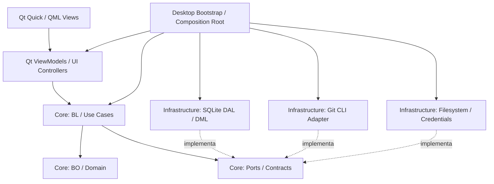
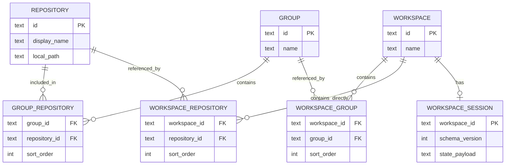

# Git Flux — Piano di progetto e architettura

> **Stato:** progettazione, prima dell'implementazione  
> **Nome:** Git Flux  
> **Documento:** versione 0.1 — 5 novembre 2026  
> **Piattaforme:** macOS · Windows · Linux  
> **Priorità assoluta:** pubblicare una **V1 usabile e affidabile**, senza compromettere l'evoluzione futura.

Questo README è la **specifica progettuale iniziale** del progetto, non la documentazione di un'applicazione già
completata. Distingue ciò che abbiamo deciso da ciò che intendiamo verificare tramite prototipi, test e decisioni
architetturali documentate.

### Stato delle decisioni

- **Deciso** — indirizzo progettuale concordato; una modifica richiede motivazione.
- **Proposto** — scelta ragionevole da validare nell'implementazione.
- **Aperto** — richiede una decisione prima del rilascio interessato.
- **Futuro** — obiettivo intenzionale, **non** impegno per la V1.

## Indice

1. [Visione, problemi da risolvere e principi](#1-visione-problemi-da-risolvere-e-principi)
2. [Ambito della V1 e non-obiettivi](#2-ambito-della-v1-e-non-obiettivi)
3. [Gruppi, workspace e sessioni](#3-gruppi-workspace-e-sessioni)
4. [Esperienza utente e design UI](#4-esperienza-utente-e-design-ui)
5. [Stack tecnologico e motivazioni](#5-stack-tecnologico-e-motivazioni)
6. [Architettura e direzione delle dipendenze](#6-architettura-e-direzione-delle-dipendenze)
7. [Moduli e confini](#7-moduli-e-confini)
8. [Modello dati e persistenza](#8-modello-dati-e-persistenza)
9. [Contratti, use case e flussi end-to-end](#9-contratti-use-case-e-flussi-end-to-end)
10. [Git Engine, credenziali e operazioni concorrenti](#10-git-engine-credenziali-e-operazioni-concorrenti)
11. [Prestazioni, caching e osservabilità](#11-prestazioni-caching-e-osservabilità)
12. [Pattern, convenzioni e struttura del repository](#12-pattern-convenzioni-e-struttura-del-repository)
13. [Qualità, test e CI multipiattaforma](#13-qualità-test-e-ci-multipiattaforma)
14. [Sicurezza, privacy e integrità dei dati](#14-sicurezza-privacy-e-integrità-dei-dati)
15. [Roadmap dopo la V1](#15-roadmap-dopo-la-v1)
16. [Milestone, criteri di accettazione e Definition of Done](#16-milestone-criteri-di-accettazione-e-definition-of-done)
17. [Rischi e mitigazioni](#17-rischi-e-mitigazioni)
18. [Open source, licenze e sostenibilità](#18-open-source-licenze-e-sostenibilità)
19. [Decisioni aperte e ADR](#19-decisioni-aperte-e-adr)
20. [Riferimenti tecnici](#20-riferimenti-tecnici)

---

## 1. Visione, problemi da risolvere e principi

### 1.1 Perché nasce il progetto

Il progetto nasce dall'esigenza di sostituire un Git client commerciale nell'uso quotidiano, eliminando alcuni attriti
osservati:

1. **Peso e reattività:** un'applicazione basata su Electron può risultare lenta o consumare più risorse di quanto
   desiderato, soprattutto con molti repository aperti.
2. **Organizzazione del lavoro:** serve scegliere tra aprire rapidamente uno o più gruppi di repository e utilizzare un
   **workspace persistente** con un vero contesto operativo.
3. **Affidabilità delle operazioni remote:** errori ricorrenti o poco chiari di autenticazione con GitHub, Bitbucket e
   altri provider non devono obbligare l'utente a risolvere il problema alla cieca.
4. **Libertà d'uso:** il set di comandi Git e le azioni disponibili non devono essere limitati per sempre a ciò che una
   specifica GUI espone.
5. **Controllo dell'esperienza:** layout, menu contestuali, scorciatoie e flussi devono poter diventare altamente
   personalizzabili.
6. **Nessun abbonamento obbligatorio:** l'utilizzo delle funzionalità locali di base non richiede un servizio cloud
   proprietario né un account applicativo.

**Posizionamento:** non un clone di GitKraken, ma **Git Flux**: un client Git desktop **local-first, moderno, modulare
ed espandibile**, progettato intorno ai contesti di lavoro e alla trasparenza delle operazioni.

### 1.2 Principi di prodotto — deciso

- **Local-first:** repository e configurazioni rimangono sul dispositivo salvo esplicite operazioni remote Git.
- **Git come fonte della verità:** branch, commit, index, working tree e remote sono governati da Git, non duplicati in
  un database applicativo autorevole.
- **Core nativo autonomo:** BO e BL in C++ standard, **senza Qt**.
- **Esperienza desktop nativa:** Qt 6 Quick/QML per la presentazione, senza WebView/Electron.
- **Responsabilità chiare:** UI, logica di business, esecuzione Git e persistenza non si mescolano.
- **Nessuna funzionalità futura al costo della V1:** predisporre punti di estensione senza sviluppare prematuramente AI,
  plugin o un docking system completo.
- **Affidabilità prima delle animazioni:** feedback visibile, errori utili, operazioni non bloccanti e nessuna modifica
  Git implicita sorprendente.
- **Multipiattaforma reale:** progettazione e test continui su macOS, Windows e Linux.

### 1.3 Cosa non promettiamo

Non promettiamo prestazioni *nettamente superiori* per definizione: le misureremo. Né promettiamo che l'applicazione
elimini ogni problema di SSH, OAuth, token o configurazione Git; deve renderli **diagnosticabili** e preferire le
integrazioni già affidabili del sistema.

---

## 2. Ambito della V1 e non-obiettivi

La **V1** è la prima release pubblica pensata per un uso personale quotidiano su progetti reali. Eventuali prototipi
tecnici e MVP interni precedono la V1 e **non sono release equivalenti**.

### 2.1 Funzionalità indispensabili — V1 / MUST

| Area                | Comportamento richiesto                                                                                                                       |
|---------------------|-----------------------------------------------------------------------------------------------------------------------------------------------|
| Catalogo repository | Registrare repository locali, importarli e aprirli senza copiarli; clonare repository remoti.                                                 |
| Gruppi              | Creare, rinominare, eliminare e riordinare gruppi; associare un repository a più gruppi.                                                      |
| Apertura rapida     | Aprire **uno o più gruppi** senza creare un workspace; mostrare l'unione dei repository senza duplicati.                                      |
| Workspace           | Creare, rinominare, eliminare e aprire workspace dedicati; associare gruppi e repository singoli.                                             |
| Sessione workspace  | Salvare e ripristinare repository/tab selezionati, filtri e stato base dei pannelli.                                                          |
| Navigazione         | Home Page a 3 colonne (Repo, Gruppi, Workspace), sidebar, tab per workspace, pannelli ridimensionabili, tema scuro e interfaccia da tastiera. |
| Stato Git           | Branch corrente, modifiche, staged/unstaged/untracked, conflitti rilevabili, ahead/behind quando disponibile.                                 |
| Commit              | Stage/unstage, diff, creazione di commit ordinari e storico essenziale.                                                                       |
| Branch              | Elenco, creazione, checkout/switch e rimozione con verifiche appropriate.                                                                     |
| Remoti              | Fetch, pull, push, visualizzazione remote e upstream, feedback su avanzamento/errori.                                                         |
| Git Graph           | Storico dei commit navigabile, collegamenti principali tra branch, selezione di commit e dettagli/diff.                                       |
| Diagnostica         | Stato dell'operazione, comando/argomenti **sanificati**, exit code, errori distinguibili e azioni correttive suggerite.                       |
| Affidabilità        | UI non bloccante; coordinamento operazioni per repository; persistenza locale transazionale.                                                  |
| Installazione       | Pacchetti per le tre piattaforme e istruzioni di build/test.                                                                                  |

### 2.2 Funzionalità desiderabili — V1 / SHOULD

- Fetch avviabile su tutti i repository di un gruppo/workspace, con risultati separati e progressi; concorrenza
  limitata.
- Scorciatoie essenziali e **Command Palette** iniziale basata su Action Registry.
- Ricerca/filtri di repository e commit, nei limiti consentiti dalla performance.
- Rilevamento dei repository mancanti o spostati e ricollegamento del percorso.
- Ripristino robusto dopo chiusura anomala dell'applicazione.
- Messaggi diagnostici SSH/HTTPS contestuali, senza gestire credenziali proprietarie.

### 2.3 Esclusioni deliberate dalla V1

**Non sono requisiti di V1**, salvo ripianificazione esplicita:

- AI locale o via API, generazione automatica del messaggio di commit e spiegazione diff.
- GUI per **tutti** i comandi/opzioni Git (`--fixup`, `rev-list`, `bisect`, ecc.).
- Editor grafico completo dei conflitti, rebase interattivo avanzato, cherry-pick e operazioni di riscrittura storia
  sofisticate.
- Editor completo dei menu contestuali e docking libero dei pannelli.
- Sistema di plugin pubblico con API stabili.
- Integrazione profonda con pull request, issue, CI/CD e servizi cloud.
- Sincronizzazione cloud dei workspace, account utente dell'applicazione, telemetria invasiva.

Queste esclusioni **non** impediscono di usare Git esternamente: la V1 non deve alterare, nascondere o impedire
l'utilizzo normale della Git CLI già installata.

---

## 3. Gruppi, workspace e sessioni

**Decisione centrale:** *gruppo*, *workspace* e *sessione di workspace* sono concetti diversi.

### 3.1 Gruppo: raccolta leggera

Un **Group** è un insieme ordinato di riferimenti a repository. Serve a organizzare e aprire rapidamente contesti di
consultazione; **non impone** un layout o una sessione persistente.

Esempi: `Cliente Alpha`, `Progetti personali`, `Open Source`.

Regole:

- Un repository può appartenere a zero, uno o più gruppi.
- Il gruppo conserva nome, identificativo, ordine e membri; non duplica i file Git.
- Aprire un gruppo non crea automaticamente un workspace.
- Si possono aprire più gruppi in **modalità rapida**; i repository presenti in più gruppi vengono mostrati una sola
  volta nella vista aggregata.
- Eliminare un gruppo non elimina alcun repository dal filesystem.

### 3.2 Workspace: ambiente persistente

Un **Workspace** è un contesto nominato che può includere **gruppi** e **repository singoli**, senza copiarli. Quando si
apre, ripristina una **WorkspaceSession**.

La sessione può salvare:

- tab/repository aperti e repository selezionato;
- filtri e ordinamenti di visualizzazione;
- dimensioni e visibilità dei pannelli;
- ultima sezione e preferenze di navigazione;
- eventuali dati di layout versionati, per evoluzioni future.

La V1 utilizza **tab di workspace dentro una finestra principale**. La modalità ibrida con workspace staccabili in
finestre indipendenti rimane una possibile evoluzione.

### 3.3 Esempio

```text
Repository Registry
├── frontend       /projects/alpha/frontend
├── backend        /projects/alpha/backend
├── infra          /projects/alpha/infra
└── portfolio      /projects/personal/portfolio

Gruppi
├── Cliente Alpha  → frontend, backend, infra
└── Frontend       → frontend, portfolio

Workspace «Lavoro Alpha»
├── gruppo: Cliente Alpha
├── repo diretto: portfolio
└── sessione: tab backend, pannello diff 35%, filtro «modified»

Modalità rapida (nessun workspace necessario)
└── gruppi aperti: Cliente Alpha + Frontend
    → frontend, backend, infra, portfolio (senza duplicati)
```

### 3.4 Regole di coerenza

1. **Identità stabile:** ogni repository registrato riceve un `RepositoryId` locale, separato dal percorso fisico.
2. **Percorso non sufficiente:** percorsi normalizzati/canonici quando possibile; verificare symlink, path non più
   esistenti, collisioni e, in futuro, linked worktree.
3. **Un Git working tree resta condiviso:** se due workspace aprono lo stesso repository fisico, `HEAD`, index e
   modifiche su disco sono gli stessi. Le sessioni non sono sandbox Git.
4. **Stato UI indipendente:** tab, filtri e disposizione pannelli possono differire tra workspace; lo stato Git no.
5. **Riferimenti dinamici:** modificare un gruppo modifica la composizione dei workspace che lo referenziano, senza
   duplicare le membership.
6. **Eliminazione sicura:** eliminare gruppo/workspace rimuove metadati applicativi; non effettua `rm -rf` delle
   directory Git.
7. **Modifiche esterne:** Git CLI/IDE possono cambiare un repository mentre l'app è aperta; la UI aggiorna o invalida la
   cache.

### 3.5 Casi limite da testare

- Un repository in tre gruppi e due workspace contemporanei.
- Ridenominazione di un gruppo già aperto.
- Repository spostato su disco o volume scollegato.
- Repo bare, submodule, worktree e cartelle con caratteri Unicode (supporto V1 da definire caso per caso).
- Arresto durante un fetch e ripristino sessione senza riavviare automaticamente comandi mutanti.
- Checkout eseguito in una vista mentre un'altra mostra lo stesso repository.

---

## 4. Esperienza utente e design UI

### 4.1 Direzione estetica — deciso

Interfaccia moderna, ispirata nella filosofia visiva a **GitKraken, Linear e VS Code**: scura, ordinata, informazioni
dense, sidebar contestuale, tab, pannelli puliti e feedback immediato. L'ispirazione **non** significa copiare branding
o asset di prodotti terzi.

### 4.2 Struttura delle viste e schermate

L'applicazione prevede due modalità di visualizzazione complementari: la **Home Page (Hub iniziale)** per la gestione e
apertura dei progetti, e la **Workspace View (Spazio operativo)** per il lavoro attivo su branch, commit e diff.

#### 4.2.1 Home Page — Hub a tre colonne

La Home Page è la schermata principale di accoglienza all'avvio (o accessibile in qualsiasi momento tramite il tab
fisso / logo Git Flux). Riflette direttamente il modello dati a tre entità del progetto:

```text
┌──────────────────────────────────────────────────────────────────────────────┐
│ ⭘ Git Flux                                                    ⚙  👤 Profile │
├───────────────────────┬──────────────────────────┬───────────────────────────┤
│ REPOS LIST        [+] │ GROUPS LIST          [+] │ WORKSPACES LIST       [+] │
├───────────────────────┼──────────────────────────┼───────────────────────────┤
│ 📁 frontend           │ 👥 Cliente Alpha         │ 💼 Lavoro Alpha           │
│    /projects/frontend │    3 repository          │    2 gruppi, 1 repo dir.  │
│                       │                          │    Ultima aperta: oggi    │
│ 📁 backend            │ 👥 Microservizi Core     │                           │
│    /projects/backend  │    5 repository          │ 💼 Sprint Corrente        │
│                       │                          │    backend + infra        │
│ 📁 infra              │ 👥 Personale             │                           │
│    /projects/infra    │    2 repository          │ 💼 Open Source Flux       │
│                       │                          │    GitFlux core           │
│ 📁 personal-blog      │                          │                           │
│    /notes/blog        │                          │                           │
└───────────────────────┴──────────────────────────┴───────────────────────────┘
```

**Caratteristiche delle tre colonne:**

1. **Header superiore:**
    - **Logo & Nome Git Flux**: identifica l'applicazione e funge da scorciatoia per tornare alla Home Page.
    - **⚙ Impostazioni**: configurazioni globali (tema, limiti concorrenza, percorsi Git, scorciatoie).
    - **👤 Profile**: gestione delle identità Git locali/globali (`user.name`, `user.email`), verifica dello stato SSH
      agent e credenziali di sistema, con eventuale supporto a profili di commit multipli (es. *Lavoro* vs *Personale*).
2. **Colonna 1 — REPOS LIST (`+`):**
    - Elenco dei repository locali registrati nel catalogo, ordinabili o filtrabili per nome/percorso.
    - Pulsante **`+`**: apre menu contestuale rapido per *«Apri cartella locale esistente»*, *«Clona da URL remoto»*,
      *«Inizializza nuovo repository»*.
    - Facendo clic su un repository lo si apre direttamente in visualizzazione singola veloce.
3. **Colonna 2 — GROUPS LIST (`+`):**
    - Elenco dei gruppi leggeri con indicazione del numero di repository membri.
    - Pulsante **`+`**: crea un nuovo gruppo e associa repository esistenti.
    - Supporta selezione singola o multipla per l' **Apertura Rapida (Quick Open)**: apre l'unione dei repository dei
      gruppi selezionati senza richiedere la persistenza di un workspace.
4. **Colonna 3 — WORKSPACE LIST (`+`):**
    - Elenco degli ambienti persistenti con anteprima della sessione salvata (tab aperti, gruppi inclusi, filtri attivi,
      ultimo accesso).
    - Pulsante **`+`**: avvia il wizard di creazione workspace (selezione gruppi + repository diretti + assegnazione
      nome).
    - Facendo clic su un workspace si ripristina istantaneamente l'intera sessione operativa.

#### 4.2.2 Workspace View — Layout operativo

Una volta aperto un repository singolo, uno o più gruppi o un workspace persistente, l'interfaccia passa alla vista
operativa con tab e pannelli modulari:

```text
┌────────────────────────────────────────────────────────────────────┐
│ ⭘ Home │ Workspace Tabs [Alpha ✕] [+]       Search   Palette   ⚙ │
├──────────────────┬─────────────────────────────────────────────────┤
│ Sidebar          │ Repository selezionato / branch / azioni Git    │
│                  ├───────────────────────────┬─────────────────────┤
│ Gruppi           │ Commit Graph / History    │ Diff / Details      │
│ Workspace        │                           │                     │
│ Repository       │                           │                     │
├──────────────────┴───────────────────────────┴─────────────────────┤
│ Operation status: fetch · push · errors · progress                 │
└────────────────────────────────────────────────────────────────────┘
```

- **Qt Quick/QML** per View, componenti e layout.
- **C++/Qt ViewModel** per proprietà osservabili e azioni invocate dalle View.
- **`QAbstractItemModel`** per liste, alberi e commit, senza copiare intere collezioni in array JavaScript.
- **`SplitView`** per ridimensionamento e salvataggio degli stati iniziali dei pannelli.
- **`Loader`**, liste virtualizzate e aggiornamenti incrementali per evitare costi nascosti.
- **Qt Quick Controls / Basic Style** come base personalizzabile, da verificare con prototipo visivo.

### 4.3 Grafico dei commit

La V1 propone righe virtualizzate e geometrie del graph calcolate in C++. Disegnare ogni collegamento come migliaia di
componenti QML indipendenti è da evitare. Se la misura lo richiede, adottare un `QQuickItem` con **Scene Graph**
personalizzato per le linee/nodi, mantenendo la parte testuale in modelli Qt.

**Non è una scelta di implementazione irrevocabile:** un prototipo con storie lunghe decide il renderer migliore.
L'obiettivo è fluidità, non una tecnologia specifica a ogni costo.

### 4.4 Accessibilità e controllo

La V1 deve prevedere navigazione da tastiera, focus leggibile, contrasto adeguato, scaling HiDPI, indicazioni testuali
accanto ai soli colori, notifiche non distruttive e dialoghi di conferma per le operazioni rischiose. Animazioni sobrie
e disattivabili in futuro.

---

## 5. Stack tecnologico e motivazioni

| Componente          | Scelta                                        | Stato               | Motivazione                                                                                                                          |
|---------------------|-----------------------------------------------|---------------------|--------------------------------------------------------------------------------------------------------------------------------------|
| Linguaggio core     | **C++23**, con verifica toolchain             | Deciso con verifica | Prestazioni e controllo; `std::expected` e strumenti C++ moderni. Valutare fallback C++20 se richiesto dalle piattaforme supportate. |
| UI desktop          | **Qt 6 Quick / QML**                          | Deciso              | Interfaccia moderna, Scene Graph, componenti riutilizzabili, nessun motore web incorporato.                                          |
| Programmazione UI   | **MVVM** + Controller mirati                  | Deciso              | Binding QML senza introdurre logica Git nella View.                                                                                  |
| Build               | **CMake** + presets                           | Deciso              | Target separati, build e CI multipiattaforma.                                                                                        |
| Persistenza         | **SQLite**                                    | Deciso              | Database locale, leggero, transazioni e migrazioni.                                                                                  |
| Motore Git          | **Git CLI installata**                        | Deciso              | Compatibilità con Git reale, configurazioni e helper esistenti; non riscrivere Git.                                                  |
| Git process adapter | Qt `QProcess` o adapter nativo                | Proposto            | Dettaglio di infrastruttura; mai una dipendenza del core.                                                                            |
| Credenziali         | SSH agent + Git credential helpers            | Deciso              | Riutilizzare i meccanismi di sistema, niente token applicativi in chiaro.                                                            |
| Test                | Core unitari, integrazione Git/SQLite, UI E2E | Deciso              | Misurare robustezza prima del rilascio.                                                                                              |

### 5.1 Perché non Electron

Il progetto nasce anche dall'esigenza di evitare un runtime Chromium incorporato e ridurre il costo base
dell'interfaccia. Non affermiamo che Electron sia sempre lento; la scelta è allineata al tipo di prodotto e alle
preferenze progettuali.

### 5.2 Perché Qt Quick anziché Qt Widgets

Widgets resta eccellente per applicazioni desktop tradizionali. Quick/QML è più adatto alla **personalizzazione visiva
moderna**, alle transizioni sobrie, ai componenti grafici custom e a un futuro sistema di layout dinamici. Il costo è
una maggiore attenzione a binding, rendering e gestione del thread GUI.

### 5.3 Perché core C++ standard senza Qt

BO/BL non importano `QObject`, `QString`, `QProcess`, `QSqlDatabase` o QML. Si usano tipi standard (`std::string`,
`std::filesystem::path`, `std::vector`, `std::expected`, ecc.). Benefici:

- test unitari del core senza SDK Qt;
- futuro eseguibile CLI o altra UI;
- migrazioni e sostituzioni tecnologiche meno invasive;
- confini verificabili nei target CMake;
- minore accoppiamento tra logica e framework.

**Conseguenza intenzionale:** al confine Qt/core occorrono conversioni, adapter e un modello di concorrenza esplicito.

---

## 6. Architettura e direzione delle dipendenze

**Stile:** **Modular Monolith + Clean Architecture pragmatica + Ports & Adapters**, con **MVVM** nella UI. Un solo
prodotto desktop, senza microservizi.



Le frecce continue rappresentano uso/dipendenze logiche; le tratteggiate indicano implementazione di contratti. **La
direzione delle dipendenze del sorgente** deve restare verso il core: i `ports` appartengono al core, le implementazioni
risiedono all'esterno. Il Bootstrap conosce i concreti per collegarli.

### 6.1 BO — Business Objects / Domain

- Entity e value object applicativi (es. `RepositoryId`, `GroupId`, `WorkspaceId`, `Workspace`).
- Enum, invarianti e regole di dominio indipendenti dall'infrastruttura.
- Nessun accesso al database, filesystem remoto o UI.
- Nessun `QObject` o conversione QML.

**Nota:** BO non significa solo strutture passive: le invarianti proprie di un oggetto possono stare nel dominio.

### 6.2 BL — Business Logic / Application

- Casi d'uso (`CreateWorkspace`, `OpenWorkspace`, `AddRepositoryToGroup`, `CommitChanges`, ecc.).
- Coordinamento dei port necessari e autorizzazioni/conferme di dominio quando applicabili.
- Validazione dei casi d'uso, errori tipizzati e risultati deterministici.
- Nessuna query SQL o esecuzione di processi direttamente.

### 6.3 Ports — interfacce del core

- `IWorkspaceStore`, `IGroupStore`, `IRepositoryCatalogStore`.
- `IGitCommandExecutor` / `IGitRepositoryReader`, eventualmente separati per capacità.
- `IFileSystem`, `IClock`, `IIdGenerator`, ove necessario per testabilità.
- Dipendenze preferibilmente **iniettate dal costruttore**, senza service locator globale.

Creare interfacce dove esiste un vero confine, **non per ogni singola classe**.

### 6.4 DAL e DML — infrastruttura di persistenza

Manteniamo la convenzione scelta per il progetto, con terminologia esplicitata:

- **DAL:** entity e mapping dello schema SQLite (es. `WorkspaceRow`, `GroupMembershipRow`).
- **DML:** query, repository concreti, transazioni, caricamento e salvataggio (es. `SqliteWorkspaceStore`).

_NB: in molti progetti «DAL» significa Data Access Layer e «DML» Data Manipulation Language SQL; questi nomi vanno
documentati ai contributori per evitare ambiguità._

Il core espone un contratto, **non** un modello tabellare. La persistenza implementa il contratto e mappa BO ↔ righe
SQLite. Modelli SQL distinti da BO si introducono quando il mapping ne trae beneficio, non automaticamente per ogni
tabella.

### 6.5 UI — Qt-specific, fuori dal core

- **View**: QML, solo layout/presentazione/interazione.
- **ViewModel**: `QObject`, `Q_PROPERTY`, segnali, comandi invocabili e stato visibile.
- **UI Models**: `QAbstractListModel` / `QAbstractItemModel` per liste e graph.
- **Controller**: navigazione, finestre, flussi di dialogo realmente complessi; **non un Controller obbligatorio per
  ogni schermata**.
- **Helper**: componenti puramente riutilizzabili, senza diventare una cartella generica per logiche senza proprietario.

### 6.6 Composizione

Il **Composition Root** dell'eseguibile desktop costruisce connessioni e adapter, poi li inietta nei servizi, infine
crea ViewModel e registra i tipi QML. La BL non costruisce direttamente `SqliteWorkspaceStore`, `QProcess` o componenti
UI.

---

## 7. Moduli e confini

| Modulo         | Responsabilità                                           | Dipendenze principali            | Proprietario dei dati                   |
|----------------|----------------------------------------------------------|----------------------------------|-----------------------------------------|
| `repositories` | Registro locale, identificativi, percorsi, disponibilità | ports filesystem/store           | Metadati dei repository registrati      |
| `groups`       | Gruppi e membership                                      | Repository IDs e storage port    | Definizione dei gruppi                  |
| `workspaces`   | Composizione workspace, apertura/chiusura, sessioni      | Group/Repository IDs e contracts | Workspace e relative sessioni           |
| `git`          | Stato Git, operazioni, branch, commit, graph             | Git executor port                | Nessun dato Git autorevole fuori da Git |
| `actions`      | Identificativi azioni, abilitazione e dispatch           | Interfacce use case              | Definizioni interne delle azioni        |
| `settings`     | Preferenze applicative, tema, default                    | Store port                       | Impostazioni                            |
| `presentation` | View, ViewModel, Qt Models, controller UI                | BL                               | Stato UI volatile e proiezioni          |
| `persistence`  | Migrazioni, SQL e mapping                                | ports e BO                       | Dati applicativi su SQLite              |
| `git-cli`      | Processo Git e parsing/diagnostica di basso livello      | OS e port Git                    | Nessuna proprietà del repository        |

### 7.1 Regole tra moduli

- Niente riferimenti circolari tra moduli.
- `groups` conserva `RepositoryId`, non oggetti di infrastruttura.
- `workspaces` conserva `GroupId` e `RepositoryId`, senza duplicarne le definizioni.
- Coordinamento intermodulo tramite casi d'uso di livello applicativo e contratti pubblici.
- Niente database condiviso consultato con SQL arbitrario da ogni modulo: gli store hanno proprietari e responsabilità
  esplicite.
- Gli eventi di dominio, se introdotti, restano tipizzati e limitati a casi reali; evitare un Event Bus globale
  onnivoro.

### 7.2 Criterio per creare un nuovo modulo

Un modulo nasce quando esistono **dati/regole propri**, responsabilità riconoscibile e un confine utile ai test. Non si
aggiunge un modulo per ogni piccola classe, schermata o comando.

---

## 8. Modello dati e persistenza

### 8.1 Entità di dominio principali

```text
Repository
  id: RepositoryId       # ID locale stabile
  displayName: string
  localPath: path
  metadata: ...           # dati applicativi, non copia del Git internals

Group
  id: GroupId
  name: string
  repositoryIds: ordered list<RepositoryId>

Workspace
  id: WorkspaceId
  name: string
  groupIds: ordered list<GroupId>
  directRepositoryIds: ordered list<RepositoryId>

WorkspaceSession
  workspaceId: WorkspaceId
  openedRepositoryIds: ordered list<RepositoryId>
  activeRepositoryId: optional<RepositoryId>
  visiblePanels: ...
  panelStateVersion: integer
  filters: ...
  updatedAt: timestamp
```

Gli ID saranno **fortemente tipizzati** nel core, per evitare di confondere ad esempio un `GroupId` con un
`RepositoryId`. Un path non è un identificatore permanente; lo spostamento deve poter essere gestito.

### 8.2 Schema relazionale iniziale — proposto



Le chiavi delle tabelle di join saranno composte e uniche, con **foreign key** e regole di cancellazione verificate.
Ordine e serializzazione del layout richiedono una convenzione deterministica. Lo schema è una base, non una migrazione
già congelata.

### 8.3 Cosa salva SQLite

**Sì:** catalogo, gruppi, membership, workspace, sessioni, preferenze, configurazioni versionate e cache ricostruibili.

**No come fonte di verità:** HEAD, index, storia dei commit, staging, remoti o working tree. Questi dati vengono letti
da Git. Non salviamo password e token in chiaro.

### 8.4 Persistenza robusta

- Migrazioni versionate e testate; backup o recovery prima di migrazioni rischiose.
- Transazioni per modifiche correlate (workspace + membership + sessione).
- Integrità referenziale e comportamento definito per record mancanti.
- Connessioni SQLite gestite in modo coerente con i thread; non condividere handle arbitrariamente.
- Politiche di journaling e recovery definite dopo test reali; WAL è un'opzione da validare.
- Session state con versione esplicita: future modifiche al layout non devono rendere l'app inutilizzabile.

---

## 9. Contratti, use case e flussi end-to-end

### 9.1 Esempio di Port

```cpp
// Esempio concettuale, non ancora API pubblica stabile.
namespace gf::workspaces::ports {

struct StorageError {
    std::string message;
};

class IWorkspaceStore {
public:
    virtual ~IWorkspaceStore() = default;

    virtual std::expected<std::optional<bo::Workspace>, StorageError>
    findById(const bo::WorkspaceId& id) = 0;

    virtual std::expected<void, StorageError>
    save(const bo::Workspace& workspace) = 0;
};

} // namespace gf::workspaces::ports
```

I casi d'uso dipendono da `IWorkspaceStore`, non da `SqliteWorkspaceStore`. Nei test sarà possibile sostituire la
persistenza con un fake/in-memory store. Errori attesi sono rappresentati da tipi (`std::expected` dove supportato),
mentre le eccezioni inattese seguono una policy separata.

### 9.2 Flusso «Crea workspace»

```text
CreateWorkspaceDialog.qml
  → WorkspaceViewModel (validazione input di presentazione)
  → CreateWorkspaceUseCase (regole BL, ID, dipendenze)
  → IWorkspaceStore (port)
  → SqliteWorkspaceStore (DML)
  → transazione SQLite
  → risultato tipizzato
  → ViewModel aggiorna il modello Qt
  → QML reagisce al cambio
```

Il ViewModel **non** esegue query SQL e non aggiorna a mano il database e la view separatamente; emette uno stato
coerente dopo il risultato del caso d'uso.

### 9.3 Flusso «Fetch gruppo»

```text
Quick Group / Workspace UI
  → Action «git.fetch.group»
  → Use case: espandi membri e deduplica RepositoryId
  → Operation Coordinator: limite di parallelismo
  → Git executor port, per repository
  → Git CLI adapter + credenziali configurate
  → risultati separati per ogni repository
  → progress events → UI Models sul thread GUI
```

Un fetch aggregato **non** diventa implicitamente un pull o un push. Operazioni con effetti diversi rimangono azioni
separate, con policy esplicite.

### 9.4 Contratti asincroni

Il core non dipende dall'event loop Qt. Le interfacce di esecuzione possono usare `std::stop_token`, callback/progress
sink tipizzati o un executor astratto, secondo i risultati del prototipo. Qt adatta questi segnali a `QObject` e
trasferisce gli aggiornamenti sul thread UI tramite meccanismi thread-safe.

---

## 10. Git Engine, credenziali e operazioni concorrenti

### 10.1 Non riscrivere Git

Le operazioni vengono eseguite utilizzando la **Git CLI del sistema**. Il programma deve rilevare posizione, versione e
capacità del Git installato e rispettare configurazioni Git locali/globali, remote, SSH agent e credential helper.

### 10.2 Componenti Git

- **Git Use Cases (BL):** `Status`, `Stage`, `Unstage`, `Commit`, `Fetch`, `Pull`, `Push`, `Clone`, gestione branch e
  lettura del graph.
- **Git Command Model (BO):** command name, lista di argomenti, working directory, modalità di input/output e policy di
  esecuzione.
- **`IGitCommandExecutor` (Port):** contratto di processo, exit code, stdout/stderr, progress, cancellazione dove
  possibile.
- **Git CLI Adapter (Infrastructure):** invocazione sicura di processi e gestione delle interazioni necessarie.
- **Git Parsers:** parsare formati destinati alle macchine (es. `git status --porcelain=v2 -z`) e output strutturati,
  non testo localizzato/colorato ove evitabile.
- **Operation Coordinator:** controllare concorrenza, conflitti, progress e cancellazione.

### 10.3 Regole di esecuzione

1. Passare **argomenti separati**, senza concatenare comandi in una shell generica.
2. Trattare path, ref e nomi branch come input non fidati; usare `--` quando previsto dalle opzioni Git.
3. Distinguere operazioni di lettura, operazioni che modificano index/working tree e operazioni remote.
4. Evitare operazioni mutanti concorrenti sullo **stesso working tree/repository**; leggere i lock reali di Git e
   prevenire conflitti anche tra finestre/workspace.
5. Non presumere che `git status` sia sempre privo di scritture: può aggiornare l'index.
6. Non assumere che l'interruzione di un comando equivalga a rollback; offrire diagnosi e recupero.
7. Per rebase/merge/reset futuri: avvisi su dirty tree, upstream, branch protetti e possibili riscritture di storia.
8. Disabilitare prompt GUI bloccanti non gestiti; introdurre un flusso esplicito per operazioni interattive.
9. Sanitizzare i log, in particolare URL con credenziali, output dei credential helper e variabili d'ambiente sensibili.

### 10.4 GitHub, Bitbucket e altri provider

**Obiettivo V1:** operazioni standard via remote HTTPS/SSH con meccanismi Git esistenti, senza obbligare a un account
centralizzato nella nostra app.

Distinguere chiaramente:

- **Identità commit:** nome/email Git;
- **Identità remote:** SSH key, HTTPS credential helper, eventuali token gestiti dai provider esterni;
- **Provider hosting:** GitHub, Bitbucket, GitLab, server Git personalizzati.

L'interfaccia diagnostica deve mostrare *quale remote*, *quale protocollo*, *quale comando sanificato* e *quale tipo di
problema* (es. credenziali, rete, autorizzazioni, branch non-fast-forward, repository inesistente), senza promettere di
identificare automaticamente ogni causa possibile.

**Sicurezza credenziali e token (Completato):**

- **Niente token in SQLite in chiaro**: crittografia a riposo autenticata con **Argon2id** (KDF memory-hard a 256-bit) e
  **AES-256-GCM** (con salt a 16 byte, IV a 12 byte e authentication tag a 16 byte).
- **Master Secret locale trasparente**: generato con `RAND_bytes` e salvato con permessi `0600` nella directory utente
  dell'applicazione (`~/.local/share/GitFlux/.vault_key`).
- **Rilevamento automatico SSH & Git config**: scansione nativa di `~/.ssh/config` e `~/.ssh/` per associare host remoti
  e chiavi SSH, `git config user.name/user.email`, e variabili d'ambiente (`GITHUB_TOKEN`, ecc.).
- **Recupero repository remoti stile GitKraken**: integrazione asincrona via API REST (GitHub, GitLab, Bitbucket, server
  custom) con filtro e ricerca istantanea in memoria e toggle SSH/HTTPS. Niente credenziali nei log.

### 10.5 Tutti i comandi Git: obiettivo futuro

Il **motore generico** nasce nella V1; **non** significa che ogni comando Git avrà subito una GUI. La roadmap prevede:

- esposizione progressiva di comandi avanzati (`commit --fixup`, `rev-list`, `cherry-pick`, `bisect`, `reflog`,
  `worktree`, ecc.);
- Command Palette e azioni contestuali;
- un eventuale **Advanced Command Runner** consapevole del repository e della versione Git, con gestione di input
  interattivo e comandi pericolosi;
- GUI specializzate per i flussi ad alto valore, indipendenti dal runner generico.

Non promettere copertura uniforme di ogni opzione Git: alcune richiedono TTY, editor, paginatori, hooks e comportamenti
particolari.

---

## 11. Prestazioni, caching e osservabilità

L'assenza di Electron **non garantisce** automaticamente un'app veloce. La performance è un requisito verificabile.

### 11.1 Strategie obbligatorie

- Caricamento **lazy** di repository, log, diff e viste QML.
- Nessun caricamento completo della storia Git all'avvio.
- Repository condivisi tra workspace tramite identità locale e **cache condivisa**, con invalidazione esplicita.
- Virtualizzazione delle liste e caricamento incrementale del commit graph.
- Debounce degli eventi filesystem, più riconciliazione periodica per eventi persi.
- Lavoro Git e SQLite oneroso **fuori dal thread GUI**.
- Aggiornare i `QAbstractItemModel` solo sul thread a cui appartengono.
- Cache con limiti di memoria; niente accumulo indefinito di diff/storie non visibili.
- Finestra e pannelli resi reattivi anche mentre un fetch o una scansione sono in corso.

### 11.2 Benchmark di progetto — proposti

I benchmark definitivi e le soglie numeriche saranno approvati **dopo una baseline riproducibile**, non inventati oggi.

| Scenario                                     | Misure                                            |
|----------------------------------------------|---------------------------------------------------|
| Avvio a freddo con 100 repository registrati | tempo percepito e misurato, picco RAM, CPU        |
| Apertura di 2 workspace con repo condivisi   | latenza di cambio contesto, memoria aggiuntiva    |
| Commit graph con circa 50.000 commit         | fluidità scroll, caricamento, memoria, rendering  |
| Fetch concorrente di 10 repository           | responsività UI, progress, errori isolati         |
| Diff molto grande / migliaia di file         | tempo fino al primo contenuto, stabilità, consumo |
| Repository aggiornato da IDE/CLI esterni     | tempo di rilevamento e correttezza cache          |

Misurare su **tutti e tre i sistemi operativi** con hardware e ambiente descritti nel report. Le metriche operative
restano **locali e opt-in per eventuale condivisione**.

---

## 12. Pattern, convenzioni e struttura del repository

### 12.1 Design pattern

| Pattern                  | Uso previsto                       | Regola                                                |
|--------------------------|------------------------------------|-------------------------------------------------------|
| **MVVM**                 | View QML ↔ ViewModel C++           | Nessuna BL nelle View                                 |
| **Repository**           | `I*Store` ↔ implementazioni SQLite | Non confondere con repository Git                     |
| **Dependency Injection** | Servizi e adapter                  | Costruttori + Bootstrap; no framework DI obbligatorio |
| **Adapter**              | SQLite, Git CLI, OS, Qt bridge     | Contratti core indipendenti                           |
| **Command**              | Action Registry e dispatch         | Azioni UI distinte dai comandi Git                    |
| **Observer**             | Cambi stato/progress               | Notifiche tipizzate, no bus globale indiscriminato    |
| **Strategy**             | Futuri backend AI/process          | Solo quando esistono varianti reali                   |
| **Factory**              | Creazione configurable di adapter  | Quando emerge la necessità                            |

**Da evitare:** singleton globali mutabili, Service Locator, god class `GitFlux`, un Controller per ogni View, utility
onnivore, ereditarietà superflua, astrazioni speculative, accessi SQLite diretti dalla UI.

### 12.2 Convenzioni di naming

- Namespace per responsabilità, es. `gf::groups::bo`, `gf::groups::bl`, `gf::groups::ports`.
- Classi e value objects con significato preciso (`WorkspaceId`, `AddRepositoryToGroup`).
- Identificativi di Action Registry stabili e gerarchici: `git.fetch`, `git.commit`, `workspace.open`,
  `group.openQuick`.
- `BO/BL/DAL/DML` conservati come convenzione richiesta, con definizioni esplicite.
- Interfacce con prefisso `I` ove utile (`IWorkspaceStore`), senza vincolo dogmatico per ogni tipo.
- Preferire tipi forti a `std::string` generiche per ID, path speciali, command context e rischi.

### 12.3 Directory suggerite

```text
git-flux/
├── README.md
├── LICENSE                     # da scegliere prima della pubblicazione
├── CMakeLists.txt
├── CMakePresets.json
├── cmake/
├── docs/
│   ├── architecture/
│   │   └── adr/
│   ├── performance/
│   └── contributing/
├── resources/
├── src/
│   ├── core/                  # C++ standard: ZERO Qt
│   │   ├── shared/
│   │   └── modules/
│   │       ├── repositories/{BO,BL,ports}/
│   │       ├── groups/{BO,BL,ports}/
│   │       ├── workspaces/{BO,BL,ports}/
│   │       ├── git/{BO,BL,ports}/
│   │       ├── actions/{BO,BL}/
│   │       └── settings/{BO,BL,ports}/
│   ├── infrastructure/
│   │   ├── persistence/
│   │   │   ├── sqlite/{connection,migrations}/
│   │   │   ├── groups/{DAL,DML}/
│   │   │   ├── workspaces/{DAL,DML}/
│   │   │   └── repositories/{DAL,DML}/
│   │   ├── git/
│   │   ├── filesystem/
│   │   └── credentials/
│   └── desktop/
│       ├── main.cpp
│       ├── bootstrap/
│       └── ui/
│           ├── qml/{views,components,layouts,themes}/
│           ├── viewmodels/
│           ├── controllers/
│           ├── models/
│           └── helpers/
├── tests/{unit,integration,e2e,performance}/
├── tools/
└── .github/workflows/
```

Le directory sono **una mappa**, non l'obbligo di creare subito centinaia di file vuoti. Un modulo viene creato quando
esiste codice da ospitare.

### 12.4 Target CMake — proposti

```text
gf_domain                # BO; nessuna dipendenza Qt
gf_application           # BL + ports; dipende dal domain
gf_persistence_sqlite    # implementa ports; SQLite C API o wrapper verificato
gf_git_cli_adapter       # implementa port Git; può usare Qt solo qui
gf_desktop               # Qt Quick, ViewModel, Bootstrap
gf_tests                 # core e integrazione
```

Non imporremo `QSqlDatabase` nel livello di persistenza: l' **API SQLite nativa** è una candidata per mantenere
l'adapter database indipendente da Qt. Se l'adapter processi usa `QProcess`, ciò resta **esterno** al core.

### 12.5 Build desiderata (non ancora disponibile)

```bash
# Obiettivo: poter costruire e testare il core senza Qt.
cmake -S . -B build-core -DBUILD_DESKTOP=OFF -DBUILD_TESTING=ON
cmake --build build-core
ctest --test-dir build-core --output-on-failure

# Obiettivo: desktop quando saranno disponibili i target e Qt SDK.
cmake -S . -B build-desktop -DBUILD_DESKTOP=ON -DBUILD_TESTING=ON
cmake --build build-desktop
```

Con Qt si utilizzerà `qt_add_qml_module` per i moduli QML. La build reale dovrà registrare le dipendenze, i file QML,
gli asset, le istruzioni di packaging e i preset dedicati a ogni piattaforma.

---

## 13. Qualità, test e CI multipiattaforma

### 13.1 Strategia di test

| Livello              | Cosa verifica                                                             | Dipendenze                     |
|----------------------|---------------------------------------------------------------------------|--------------------------------|
| Unit — BO            | invarianti, ID, membership, regole                                        | Solo standard C++              |
| Unit — BL            | use case, error handling, edge case                                       | fake ports / in-memory stores  |
| Integration — SQLite | query, mapping, migrazioni, rollback                                      | database temporanei            |
| Integration — Git    | branch, stage, commit, fetch, conflitti, submodule/worktree dove previsto | repository Git temporanei      |
| UI / E2E             | sessione, QML, navigation, operazioni end-to-end                          | app desktop                    |
| Performance          | graph, repo multipli, memoria, regressioni                                | fixture e hardware documentati |

### 13.2 Matrice CI

- **Windows:** toolchain MSVC/Clang da stabilire, path Windows e credential handling.
- **macOS:** Apple Clang, filesystem, bundle e notarizzazione da pianificare.
- **Linux:** distribuzione/ABI di riferimento, X11/Wayland, dipendenze WebKit **non** richieste da Qt Quick ma backend
  grafico e plugin Qt da testare.

La CI deve **compilare il core senza Qt** almeno in una job dedicata. Aggiungere static analysis, clang-format,
clang-tidy, test e packaging man mano che il progetto cresce. Verificare la disponibilità reale delle funzionalità C++23
sulle toolchain minime.

### 13.3 Fixture Git

Generare repository sintetici in cartelle temporanee: clean/dirty, detached HEAD, divergenza upstream, merge conflict,
file Unicode, symlink, storia lunga, remoti locali, credenziali fallite simulate. I test ordinari **non devono
dipendere** dall'uptime di GitHub o Bitbucket.

---

## 14. Sicurezza, privacy e integrità dei dati

- Nessuna richiesta di account proprietario per l'uso locale.
- Nessun upload di repository, diff o commit verso servizi esterni senza azione esplicita.
- Git credential helpers e SSH agent gestiscono credenziali; non conservarle in SQLite o log applicativi.
- Sanitizzazione di stdout/stderr e URL remoti quando vengono visualizzati o salvati.
- Argomenti processi separati dalla shell; path e ref trattati come input potenzialmente ostili.
- Il software non promette undo universale: differenziare azioni reversibili, rischiose e distruttive.
- Conferma prima di operazioni che possono perdere lavoro o riscrivere storia.
- Un workspace non isola le modifiche Git; mostrare chiaramente gli effetti condivisi.
- Cancellazione di metadati applicativi distinta dalla rimozione fisica dei repository.
- Backup/migrazioni per proteggere il database e capacità di ripristino dopo crash.
- Nessuna telemetria remota predefinita; eventuali diagnostiche condivise richiedono opt-in.

Per le future **azioni utente personalizzate** e i **plugin** saranno necessarie capacità, permission model, review e
controlli di sicurezza separati: non basta aprire la possibilità di eseguire comandi arbitrari.

---

## 15. Roadmap dopo la V1

La roadmap segue **priorità e dipendenze**, non date vincolanti. La progressione può cambiare dopo l'uso personale della
V1.

### Fase 0 — Proof of Concept tecnica

- Compilare una libreria di core **senza Qt**.
- Mostrare una finestra Qt Quick con sidebar, tab e modelli C++.
- Eseguire Git CLI fuori dal thread UI, con output e cancellazione controllata.
- Provare apertura di 100 repository e graph di circa 50.000 commit.
- Misurare RAM, startup, responsività e comportamento delle tre piattaforme.

**Gate:** confermare Qt Quick, versioni minime di Qt/Git/C++ e l'approccio di rendering.

### Fase 1 — Fondamenta della V1

> **Documento di dettaglio ed avanzamento:** [`docs/phase1-foundation.md`](phase1-foundation.md)

- Repository Registry, ID stabili e path management.
- Gruppi e modalità rapida con più gruppi aperti.
- Workspace e sessioni persistenti.
- Schema SQLite, migrazioni, stores e test.
- Contratti BO/BL/ports e Git executor.

### Fase 2 — V1 funzionale

- Status, stage/unstage, diff e commit.
- Branch, clone, fetch, pull, push.
- Credential diagnostics e gestione errori.
- Commit graph incrementale.
- Session restore, Operation Center, theme e shortcut base.
- Test di regressione, packaging e release candidate.

### Fase 3 — V1.x: Git avanzato e qualità d'uso

- `git commit --fixup` e integrazione `autosquash` quando sicura.
- `git rev-list`, `reflog`, `cherry-pick`, tag, stash e altri comandi utili.
- Merge/rebase avanzati, conflict editor dove giustificato.
- Fetch/pull/push di gruppo con policy e conferme appropriate.
- Worktree, submodule e repository speciali con UX dedicata.
- Miglioramenti della ricerca, graph e diagnostica.

### Fase 4 — V2: personalizzazione profonda

- **Action Registry** esteso: l'utente decide quali azioni compaiono nel menu contestuale di un commit, nell'ordine
  desiderato, con separatori e shortcut.
- **Layout Manager**: pannelli spostabili, docking, preset e ripristino versionato.
- Workspace staccabili in finestre indipendenti; possibili layout multi-monitor.
- Advanced Command Runner con version detection, policy di sicurezza e operazioni interattive supportate.
- Preferenze per workspace/gruppo, Command Palette avanzata e workflow configurabili.

### Fase 5 — V2+ / V3: assistenza AI

- `IAIProvider` indipendente da UI e vendor.
- **Locale:** adapter verso Ollama e/o llama.cpp (scelta da validare).
- **API:** OpenAI, Anthropic ed endpoint compatibili, senza obbligo di provider specifico.
- Generazione dei messaggi di commit a partire da staged diff, spiegazioni di commit/diff e suggerimenti non
  distruttivi.
- Privacy per repository sensibili: conferma prima di inviare codice all'esterno, redazione dove possibile, salvataggio
  sicuro delle API key.
- Nessuna modifica automatica del codice o di Git senza consenso esplicito.

### Fase 6 — Ecosistema e integrazioni

- Plugin API **solo quando il core e i contratti si saranno stabilizzati**.
- Integrazioni hosting: pull request, issue, CI, review (GitHub, Bitbucket, GitLab dove compatibili).
- Azioni condivisibili, estensioni, scripting/sandbox da progettare e documentare.
- Eventuale CLI autonoma che utilizza gli stessi use case core.
- Possibili modalità di distribuzione e sostenibilità alternative, da valutare senza penalizzare l'uso base della
  versione open source.

---

## 16. Milestone, criteri di accettazione e Definition of Done

### V1 pronta quando…

- [x] Si può registrare, importare e clonare un repository reale.
- [x] Si possono creare gruppi, associare repository a più gruppi e **aprire più gruppi rapidamente** senza workspace.
- [x] Si possono creare **workspace dedicati**, includere gruppi e repo diretti, chiuderli e ripristinare tab e stato
  base.
- [x] Repository condivisi tra workspace non producono copie o stati Git contraddittori.
- [x] Status, stage, diff, commit, branch, fetch, pull e push funzionano sui casi principali e restituiscono errori
  utili.
- [x] Il graph è navigabile e caricato progressivamente.
- [x] Git non blocca il thread UI e operazioni mutanti sul medesimo repository non si sovrappongono in modo pericoloso.
- [x] I normali meccanismi SSH/HTTPS del sistema funzionano e i problemi più comuni sono diagnosticabili.
- [x] I test su core, SQLite, Git e UI coprono i flussi critici.
- [x] Il core compila in CI **senza Qt**.
- [x] Esistono pacchetti/istruzioni verificati per macOS, Windows e Linux.
- [x] È stata scelta e pubblicata una licenza coerente con dipendenze, contributi e piani futuri.
- [x] È presente una documentazione per build, sicurezza, architettura e limiti noti.
- [x] I benchmark principali sono stati raccolti; le regressioni critiche sono risolte o dichiarate.

### Definition of Done per una feature

1. Requisito e comportamento documentati, inclusi errori e casi limite.
2. Dipendenze conformi all'architettura; Qt assente dal core.
3. Test adeguati aggiunti e passati sulle piattaforme pertinenti.
4. Nessun blocco del thread GUI o operazione Git non coordinata.
5. Test di sicurezza su input, dati sensibili e perdita di modifiche quando applicabile.
6. UX e diagnostica comprensibili; documentazione aggiornata.
7. Eventuale decisione architetturale registrata in ADR.

---

## 17. Rischi e mitigazioni

| Rischio                                       | Impatto    | Mitigazione                                                                         |
|-----------------------------------------------|------------|-------------------------------------------------------------------------------------|
| QML/graph poco fluido                         | Alto       | PoC anticipata, virtualizzazione, modelli C++, renderer custom solo se necessario   |
| Troppa architettura prima del prodotto        | Alto       | Vertical slice funzionanti, poche interfacce con confini reali, no plugin prematuri |
| Differenze Git fra versioni e OS              | Alto       | Rilevamento versione/capacità, test matrix e output parsabili                       |
| Credenziali complesse                         | Alto       | Riutilizzare helper Git, SSH agent, diagnostica anziché account proprietari         |
| Modifiche concorrenti sullo stesso repository | Alto       | Operation coordinator, lock, eventi di invalidazione, serializzazione mutazioni     |
| Stato sessione corrotto                       | Medio      | Versioning, transazioni, migrazioni testate e fallback                              |
| Repository enormi / diff giganteschi          | Alto       | Lazy load, limiti cache, cancellazione, profiling                                   |
| Problemi HiDPI/Wayland/macOS                  | Medio/alto | E2E e smoke test multipiattaforma                                                   |
| Licenza Qt o contributi incompatibili         | Alto       | Audit moduli/licenze prima della pubblicazione, policy contributi                   |
| Scope creep: AI e funzioni avanzate           | Alto       | V1 bloccata tramite MUST/SHOULD/OUT; ADR per ogni cambiamento di scope              |

---

## 18. Open source, licenze e sostenibilità

### 18.1 Obiettivo — deciso

L'intenzione iniziale è pubblicare il progetto **open source**. L'autore si riserva di valutare in futuro distribuzioni
o prodotti con condizioni differenti, ma la strategia concreta va definita **prima** di accettare contributi
significativi.

### 18.2 Licenza progetto — aperto

Candidati discussi: **MIT** oppure **Apache-2.0** (permissive), oppure una licenza copyleft se l'obiettivo cambierà.
**Non si dichiara il progetto già coperto da una licenza specifica.** Prima della pubblicazione sarà creato il file
`LICENSE` con testo corretto e anno/titolare.

Una licenza open source già concessa **non può essere revocata retroattivamente** ai destinatari di versioni distribuite
sotto quei termini. Un cambio di licenza per **versioni future** richiede i diritti necessari su tutto il codice
incluso, compresi i contributi esterni. Se serve flessibilità futura, valutare con attenzione **CLA**, eventuale dual
licensing e policy contributi; non presumere che un semplice `CONTRIBUTING.md` basti a ottenere diritti aggiuntivi.

### 18.3 Qt e dipendenze — controllo necessario

Qt è disponibile con varie licenze, inclusa **LGPLv3** per numerosi moduli, mentre alcuni moduli sono disponibili sotto
GPL o licenza commerciale. Occorre:

- scegliere consapevolmente i componenti Qt utilizzati;
- rispettare gli obblighi applicabili al modo di distribuzione/linking;
- documentare licenze e avvisi di dipendenze terze;
- verificare le condizioni prima di pubblicare pacchetti binari;
- riesaminare i termini se in futuro cambia la strategia di distribuzione.

Questa sezione è un promemoria progettuale, **non consulenza legale**.

### 18.4 Community futura

Quando il progetto sarà pubblico: `CONTRIBUTING.md`, `CODE_OF_CONDUCT.md` se ritenuto utile, issue/PR template, SECURITY
policy, istruzioni di sviluppo, guida ai test, changelog e linee guida per i contributi. Le API plugin pubbliche non
sono previste nella V1.

---

## 19. Decisioni aperte e ADR

### 19.1 Decisioni consolidate

| ID      | Decisione                                                         | Motivo                                              |
|---------|-------------------------------------------------------------------|-----------------------------------------------------|
| ADR-001 | Desktop multipiattaforma macOS/Windows/Linux                      | Un'unica applicazione Git Flux per diversi ambienti |
| ADR-002 | C++ standard nel core (BO/BL), senza Qt                           | Portabilità, testabilità, evoluzione                |
| ADR-003 | Qt 6 Quick/QML invece di Electron/Qt Widgets per la UI            | Design moderno, rendering nativo e controllo        |
| ADR-004 | MVVM per la UI + Controller mirati                                | Separazione presentazione/operazioni                |
| ADR-005 | Modular Monolith + Ports & Adapters                               | Crescita controllata senza microservizi             |
| ADR-006 | Git CLI come motore reale                                         | Evitare duplicazione della semantica Git            |
| ADR-007 | SQLite per metadati applicativi                                   | Persistenza local-first robusta                     |
| ADR-008 | Gruppi leggeri e workspace persistenti **entrambi** nella V1      | Due modalità d'uso indipendenti                     |
| ADR-009 | Action Registry predisposto, personalizzazione avanzata futura    | Estendibilità senza scope creep                     |
| ADR-010 | Open source come intenzione iniziale, licenza ancora da scegliere | Trasparenza e possibilità di evoluzione             |

### 19.2 Questioni ancora aperte

- **Identità visiva** del progetto (il nome **Git Flux** è stato definito).
- **Licenza definitiva** (MIT/Apache-2.0/altro), contributi e eventuale CLA.
- **Toolchain/versioni minime**: Qt 6.x, Git, macOS/Windows/Linux e compilatori che supportino C++23 necessario.
- **Git Process Adapter**: `QProcess` nell'infrastruttura desktop oppure libreria/process adapter nativo indipendente da
  Qt.
- **Renderer graph** definitivo e obiettivi quantitativi di performance.
- **Limiti V1** su submodule, bare repository, worktree e operazioni Git interattive.
- **Modalità multi-finestra** (tab nella V1, docking/finestre future).
- **Policy per gruppi eliminati** ma referenziati da workspace (rimozione automatica delle associazioni o impedimento
  con conferma).
- **Formato layout** e policy di upgrade delle sessioni.
- **Criteri per taggare la V1**: soglie e hardware benchmark di riferimento.
- **Packaging, firma e distribuzione** nelle tre piattaforme.

### 19.3 Template ADR

Ogni cambiamento significativo va registrato in `docs/architecture/adr/NNN-titolo.md` con:

```markdown
# ADR-NNN — Titolo

Status: Proposed | Accepted | Superseded
Date: YYYY-MM-DD

## Contesto

## Decisione

## Alternative considerate

## Motivazioni e trade-off

## Conseguenze

## Validazione / test richiesti
```

**Principio:** non trasformare preferenze temporanee in dogmi; decidere con criteri espliciti e verifiche.

---

## 20. Riferimenti tecnici

Fonti ufficiali da consultare durante l'implementazione (la documentazione prevale sugli esempi sintetici di questo
README):

- [Qt 6 — Licensing](https://doc.qt.io/qt-6/licensing.html) — licenze per moduli e distribuzione.
- [Qt 6 — Qt Quick Scene Graph](https://doc.qt.io/qt-6/qtquick-visualcanvas-scenegraph.html) — renderer nativo e
  componenti personalizzati.
- [Qt 6 — `qt_add_qml_module`](https://doc.qt.io/qt-6/qt-add-qml-module.html) — integrazione QML e CMake.
- [Qt 6 — `SplitView`](https://doc.qt.io/qt-6/qml-qtquick-controls-splitview.html) — ridimensionamento e stato pannelli.
- [Git — Credentials](https://git-scm.com/docs/gitcredentials) — credential helper e autenticazione.
- [Git — `git-status`](https://git-scm.com/docs/git-status) — formati machine-readable, incluso `--porcelain=v2 -z`.
- [Git — `git-commit`](https://git-scm.com/docs/git-commit) — opzioni `--fixup` e altri flussi commit.
- [Git — `git-rev-list`](https://git-scm.com/docs/git-rev-list) — navigazione commit e revisioni.
- [Git — `git-worktree`](https://git-scm.com/docs/git-worktree) — worktree multipli, evoluzione futura.
- [Open Source Initiative — FAQ](https://opensource.org/faq) — licenze e accordi con i contributor.

---

## Sintesi della strategia

> **Prima un Git Flux V1 stabile e piacevole da utilizzare; poi un ambiente Git avanzato, personalizzabile e con AI
opzionale.**
>
> Le fondamenta devono supportare il futuro, ma non è necessario costruirlo tutto oggi.

**Prossimo passo tecnico consigliato:** creare una **vertical slice** con
`Repository Registry → Group → Workspace → SQLite → ViewModel Qt → QML`, corredata da test unitari del core e una prima
migrazione; in parallelo validare `Git CLI Adapter + Operation Coordinator` con repository temporanei. Solo dopo
misurare il commit graph e definire le soglie di performance della V1.
